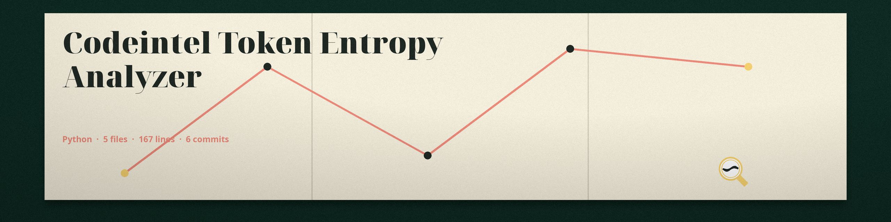

# codeintel-Token-Entropy-Analyzer
Calculates the entropy of tokens (API keys, passwords, secrets) in code and configuration files. High entropy tokens are statistically less predictable and potentially more secure (but still should not be hardcoded). Focused on tools for static code analysis, vulnerability scanning, and code quality assurance.

## Install
`git clone https://github.com/ShadowGuard-AI/codeintel-token-entropy-analyzer`

## Usage
`python3 main.py FILEPATH [--min_length N] [--regex REGEX] [--entropy_threshold THRESHOLD]`

## Parameters
- `-h`: Show help message and exit
- `filepath`: Path to the file to analyze. Required.
- `--min_length`: Minimum length of tokens to consider (default: 8).
- `--regex`: Regex to define tokens (default: [A-Za-z0-9_\-]+). Be careful with special regex characters.
- `--entropy_threshold`: Entropy threshold to flag tokens (default: 3.0).

## Verified behavior
- A 20 character token with entropy 4.06 is reported as a potential secret, and the run exits 0.
- A token shorter than `--min_length` is not reported.

## License
See LICENSE.
