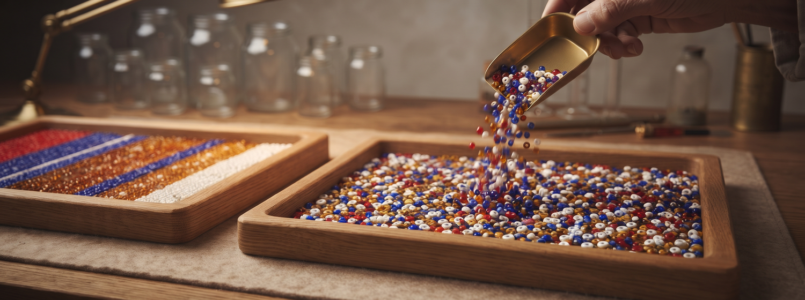
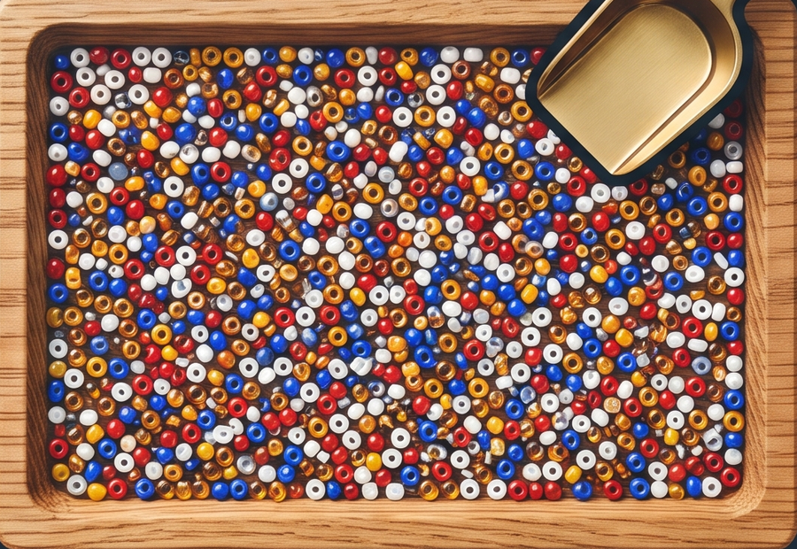
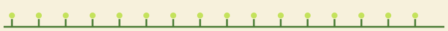
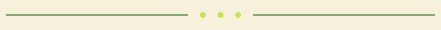

# codeintel-Token-Entropy-Analyzer

Title block: the name above is set in Beth Ellen in black spot on a cream plate in field guide entry style, the common name first, with a small glow worm beside this first heading only. Later headings keep the plate style without the animal.

Calculates the entropy of tokens (API keys, passwords, secrets) in code and configuration files. High entropy tokens are statistically less predictable and potentially more secure (but still should not be hardcoded). Focused on tools for static code analysis, vulnerability scanning, and code quality assurance.

## Install
`git clone https://github.com/ShadowGuard-AI/codeintel-token-entropy-analyzer`

## Usage
`python3 main.py FILEPATH [--min_length N] [--regex REGEX] [--entropy_threshold THRESHOLD]`

## Parameters

> **Field note: The Token Itself Is Printed.** A flagged token is printed with its value in full, and tokens below the flag threshold are still written to the log with their values when their entropy is above zero. A saved log from a run is to be handled as material that contains secrets. No token value is reproduced in this README.

> **Field note: exact tests.** The length test is at or above the floor, so a token of exactly the minimum length is considered; the entropy test is at or above the threshold, so a token that scores exactly the threshold is flagged; and token values are found with the full match of the pattern, so capture groups still yield whole tokens.
- `-h`: Show help message and exit
- `filepath`: Path to the file to analyze. Required.
- `--min_length`: Minimum length of tokens to consider (default: 8).
- `--regex`: Regex to define tokens (default: [A-Za-z0-9_\-]+). Be careful with special regex characters.
- `--entropy_threshold`: Entropy threshold to flag tokens (default: 3.0).

## Verified behavior
- A 20 character token with entropy 4.06 is reported as a potential secret, and the run exits 0.
- A token shorter than `--min_length` is not reported.

> **Field note: exit rules live on the website.** A missing file, an unreadable file, a minimum length at or below zero, a negative threshold, or an invalid pattern each ends the run at exit 1; a completed scan exits 0 and a flagged token does not change that value. Those rules come from the code and are marked as code facts on the website.

## License
See LICENSE.
